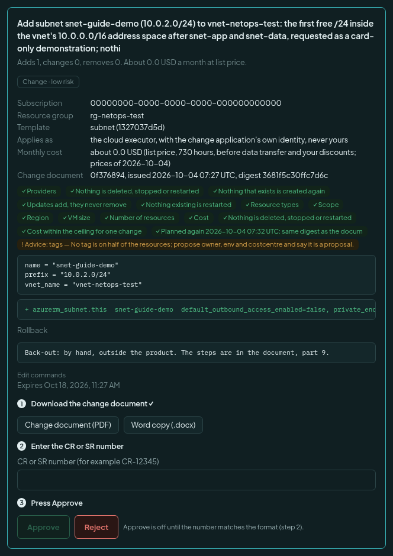
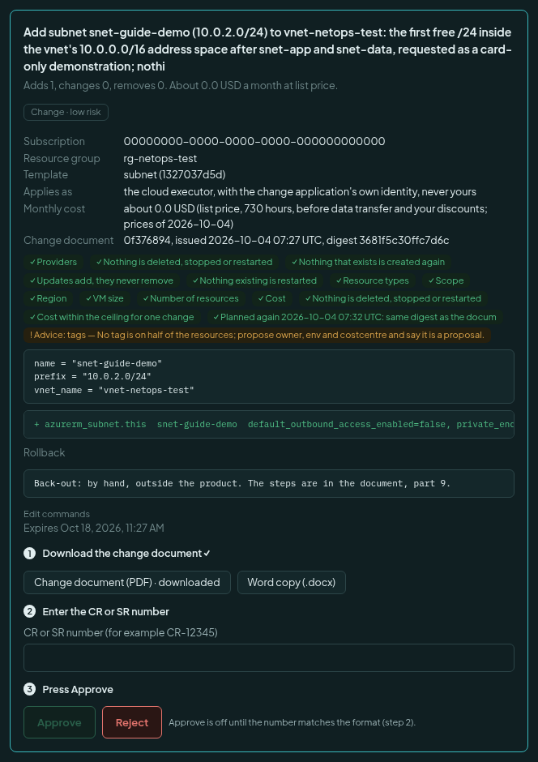
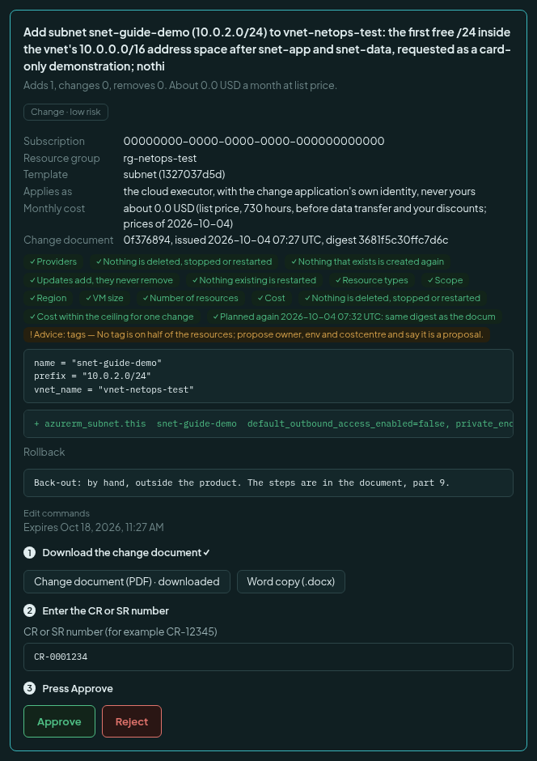
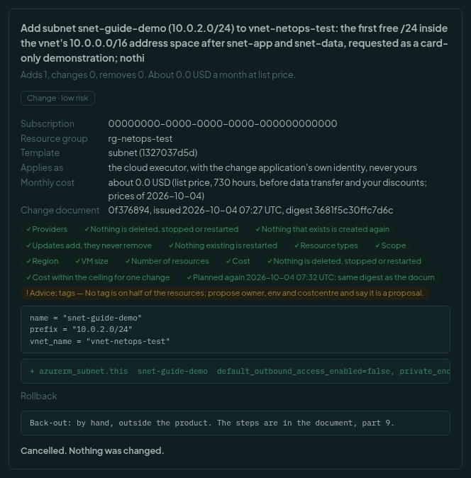
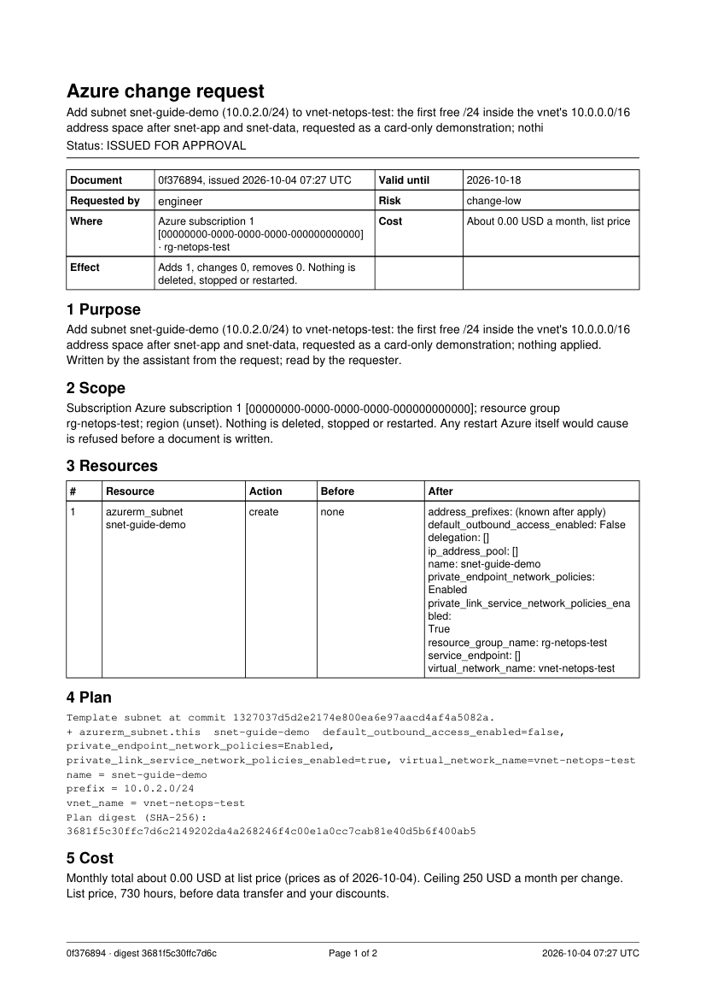
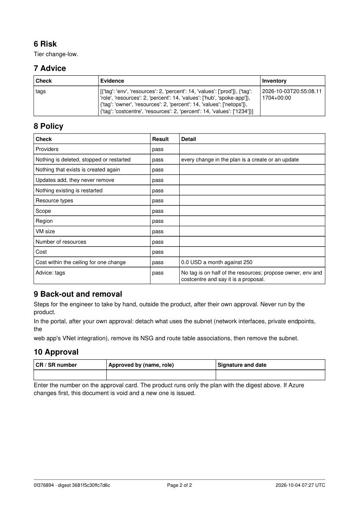
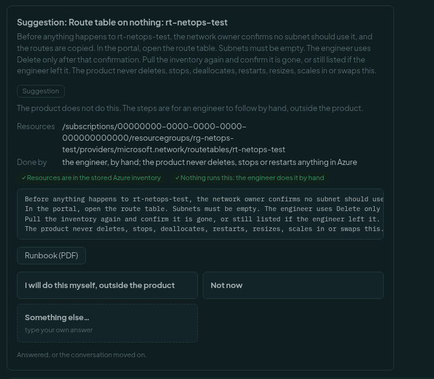
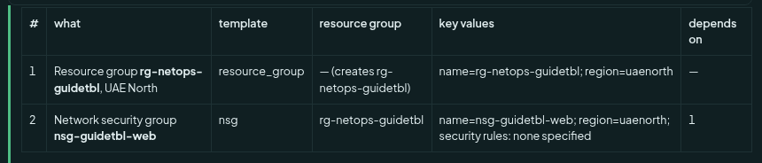
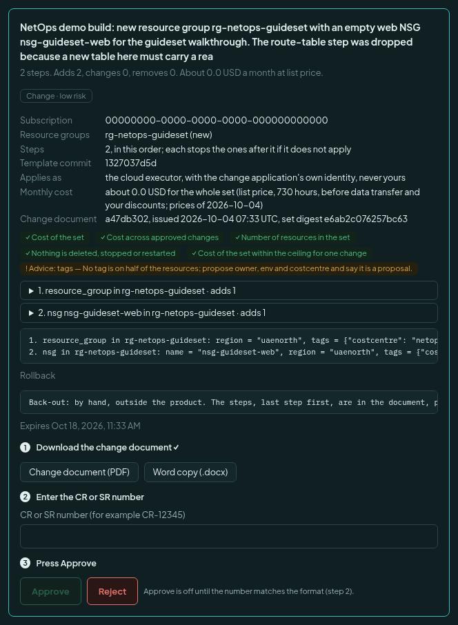
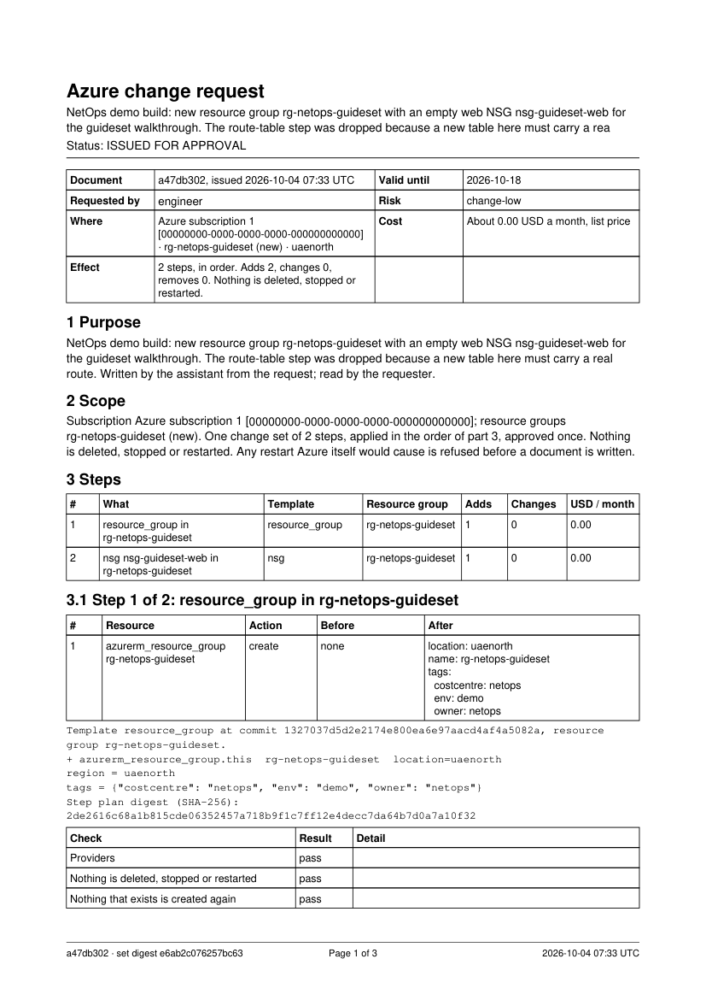

# Ask for, approve and apply an Azure change

This guide is for engineers. It shows how a change goes from your question to Azure. Azure changes are an optional
feature. An administrator must set them up first: [Set up Azure changes](azure-changes-setup.md).

Rules to remember:

- The assistant asks. **You** approve. Typing "approved" in the chat approves nothing.
- You can approve **only the changes you asked for**.
- Every change needs a **change document** and a **CR or SR number**.
- Nothing is ever deleted, stopped, restarted, resized or replaced. Those become a *suggestion* (below).

Reference: [Azure changes](azure-changes.md).

## 1. Ask in the chat

Open **Chat**, pick *NetOps Operator*, and say what you want. Be exact: the subscription, the resource group, the
name, the address. For example:

> In resource group rg-netops-test, add a new subnet named snet-guide-demo to the virtual network vnet-netops-test,
> using a free /24 inside the network's address space.

The assistant reads the inventory, checks the address is free and checks the names. It builds the change from a
reviewed template. Then the product plans it with the real tools. The plan is checked against the guard rails: only the
allowed subscriptions, groups, regions and types, only within the cost limits, and nothing deleted, replaced or
narrowed. **A plan that fails a check shows no card.** The assistant tells you why.

## 2. The card

A plan that passes appears as a card in the chat.

Read it from the top:

- The title and the sentence of what changes. *Adds 1, changes 0, removes 0.*
- The risk tag (here *Change · low risk*), the subscription, the resource group and the template.
- **Applies as**: the cloud executor, with the change application's own identity, never yours.
- **Monthly cost**, at list price.
- **Change document**: its number and the plan's digest. The digest is a fingerprint of the exact plan.
- Green ticks for each check the plan passed. An orange line is advice, for example "no tag is on half of the
  resources". It does not block.
- The values and the plan lines. `+` is an addition. `~` is a change. There is never a removal.
- **Rollback**: the back-out is by hand, outside the product. The steps are in the document.
- **Expires**: a draft is valid for the number of days the administrator set (14 by default).

At the bottom are the three numbered steps.

## 3. The three steps

### Step 1: download the change document

Press **Change document (PDF)**. A Word copy is also there. Open the file and read it.

Approve stays off until you have downloaded the document. After you do, the step gets a tick, and the button reads
*downloaded*.

### Step 2: enter the CR or SR number

Type the number of the change request in your format. For example `CR-0001234`. The format is set by your
administrator. If the number does not match, Approve stays off, and the reason is written beside it:
*Approve is off until the number matches the format (step 2).*

### Step 3: press Approve

When both steps are done, **Approve** is lit. You can also press **Reject**. Reject needs neither the document nor
the number. Nothing changes in Azure.

The card asks the server for its change's state. After a reload, or in another browser, it still knows what was
downloaded. When a change is approved, rejected, applied, superseded, cancelled or expired, the card says so, with the
number, who and when. It does not show live buttons any more.

A change is *superseded* when a newer plan replaces it, for example when you ask the assistant to draft it again. The
old card and its document are void. Use the newest card.

## 4. What the document contains

The document is a PDF (and a Word copy) for the people who manage change. It is the record of exactly what you
approve. One page is shown here.

The parts, in order:

1. **Purpose**: what the change is for.
2. **Scope**: the subscription, resource group and region. Nothing is deleted, stopped or restarted.
3. **Resources**: each resource, the action (create or update), what it was before and what it will be.
4. **Plan**: the template, the values and the plan's digest.
5. **Cost**: the monthly total at list price, and the ceiling.
6. **Risk**: the tier.
7. **Advice**: the checks the assistant ran, with the evidence and the time of the inventory.
8. **Policy**: each guard rail and whether it passed.
9. **Back-out and removal**: the steps for an engineer to take **by hand**, after their own approval. The product never
   runs them.
10. **Approval**: a box for the CR or SR number, the approver and the signature.

The second page has parts 6 to 10.

A document is void if a newer plan replaces it, or if Azure changes first and the plan no longer matches.

## 5. Apply

When you press **Approve**, the product checks again that the approval, the number and the document are what you
approved. Then the executor plans the change again.

- **If the plan is the same:** it applies once. Then it checks that Azure now matches what was intended. Then it reads
  the subscription back into the inventory.
- **If the plan is not the same** (Azure changed meanwhile, or the guard rails did): it stops. The change is
  *superseded* and a new document is made. Nothing is applied.

The assistant tells you what happened.

### The as-applied document

After an apply, a **second version of the document** is written. It records the result. Its status line reads *AS
APPLIED*. Download it from the card, or from the list of changes. It is the proof to attach to your request. If the check
afterwards did not find the intended state, the document and the card say so.

The list of changes shows each change with the number it was approved under, its digest and its documents. Reviewers
may list and download everyone's.

## 6. A suggestion: when the answer is "remove it"

The product never removes, stops, restarts, resizes or scales in. When you ask for one, the assistant writes a
**suggestion**. It is a card with the evidence and a **runbook** (PDF): what to check first, the portal steps, how to
confirm.

Ask, for example: *The route table rt-netops-test is not needed any more. I want it removed. Write the suggestion with
its runbook.*

Note the words on the card: *The product does not do this. The steps are for an engineer to follow by hand, outside the
product.* There is no Approve button. No code path leads from a suggestion to Azure. You do the steps yourself. The next
inventory pull shows whether it happened.

## 7. A change set: a whole build, one number

A hub network with its subnets and peerings is one request. So it is one **change set**. You get **one card, one
document, one CR or SR number and one Approve**.

### First, the steps in the chat

The assistant first shows the steps as a table in the chat. It asks if you want to draft them as one change set. It
drafts only after you say yes.

The columns are: the step number, what it makes, the template, the resource group, the key values, and which step it
depends on. Step 2 depends on step 1 here, because the group must exist first. A set has two to twelve steps. The order
is yours. The assistant never reorders it.

If one step cannot be made (for example a template does not exist), the assistant tells you before drafting and
asks what to do. It may offer to drop that step.

### Then the one card

The card shows the whole set: the number of steps, the cost of the whole set, and the checks. The steps are shown
collapsed. Press a step to see its plan lines. The three numbered steps work as before.

The limits count the **sum** of the steps. A set has no Edit button. To change it, ask the assistant to draft it
again. The old card then says it was superseded.

### The document of a set

The document has a table of the steps, then a section for each step, then the checks, the back-out (last step first)
and the approval box.

### What "stopped at step k" means

Steps apply in order. Before each step, the product checks that the approval, the number, the document and the steps are
still what you approved. It plans that step again.

If a step does not apply, **the set stops there**. The reason can be: the plan changed, the apply failed, or the check
afterwards did not find the intended state. Then:

- The later steps never run.
- **Nothing is rolled back.** The product never deletes.
- A step is not tried again under the same approval.
- The card says *Applied k-1 of n. Stopped at step k.* with a mark for each step.
- The as-applied document says *AS APPLIED, PARTIAL (k-1 of n)*. It lists the back-out of the steps that did apply,
  last first.
- The assistant tells you what applied, what stopped and why, what did not run, and that nothing was rolled back.

To do the rest, ask the assistant to continue. It drafts the remaining steps as a **new set**, plans them again, and
gives you a new document and a new approval. Type the number again. The same CR or SR number is accepted, because
whether one request covers the remainder is your process, not the product's.

A set that is slow has not failed. The executor takes six requests a minute, so a set of many quick steps pauses
between steps and carries on.

## Not pictured

Three screens come only after a real apply, and are described above instead of shown: the card right after **Approve**
(it reads *Approved with CR-… by …*, then *Applied*), the as-applied document, and a set that stopped at step k.
