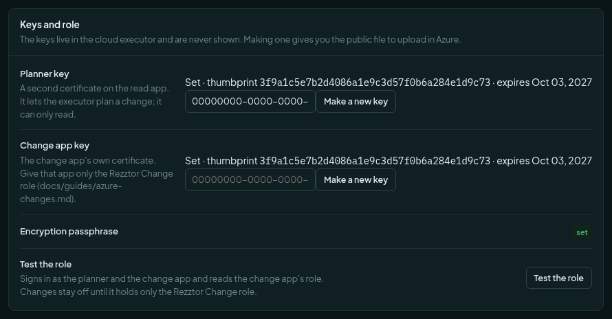
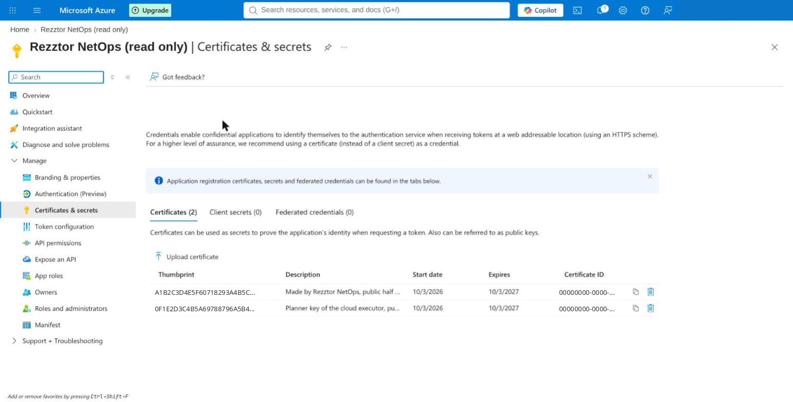
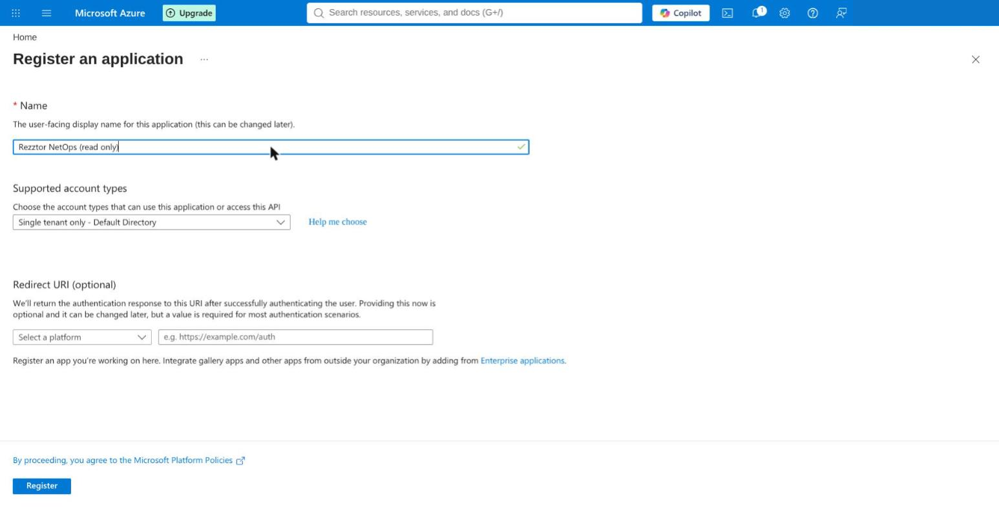
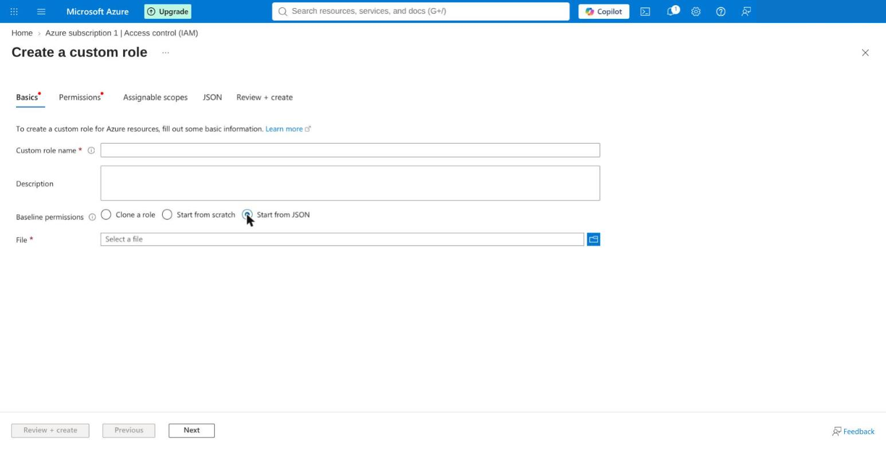
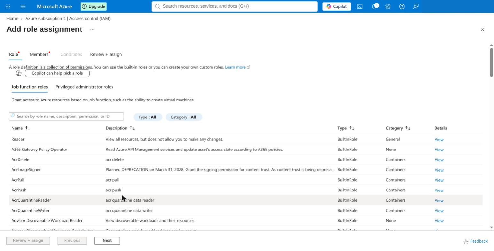
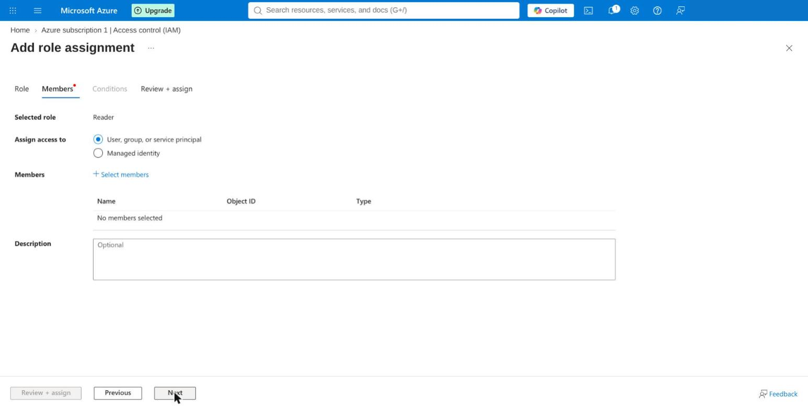
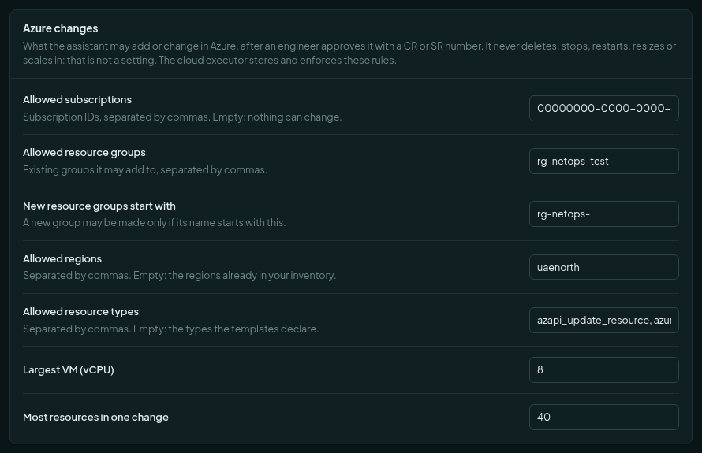
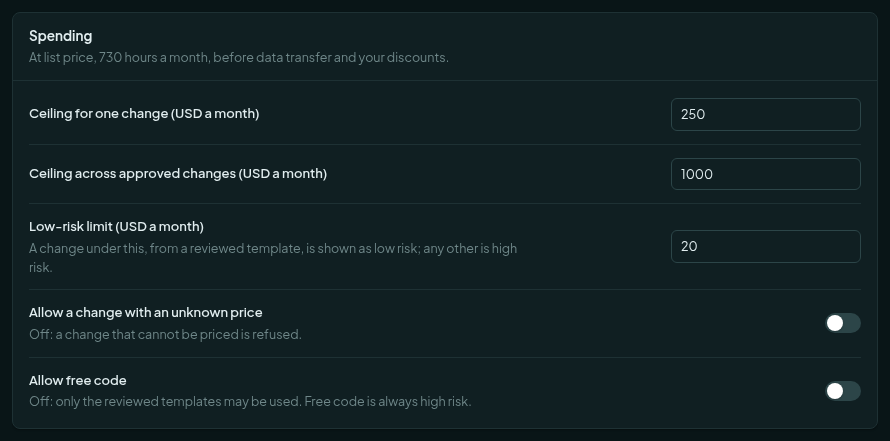
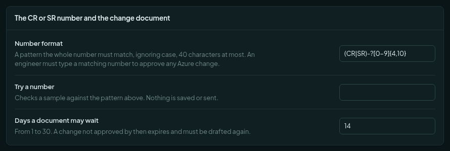

# Set up Azure changes (optional)

The product works fully without this guide. [Connecting Azure read-only](azure-setup-read-only.md) already gives
you the inventory, advice, waste, cost and troubleshooting. This guide adds one more thing: the assistant can
**add or change** a resource in Azure, but only after an engineer approves it with a CR or SR number.

Do this only if you want that. It takes about thirty minutes. You need the read-only setup done first.

Next: [Approve a change](azure-approving-a-change.md). Reference: [Azure changes](azure-changes.md).

## What the product will never do

These are not settings. No switch, no argument and no confirmation changes them. The Azure role the product runs as
does not allow them either.

| It never does this | What happens instead |
| --- | --- |
| Delete anything. | The assistant writes a *suggestion* with a runbook. An engineer does it by hand. |
| Stop, deallocate, restart, resize, scale in, or swap a deployment slot. | The same: a suggestion. |
| Replace a resource (Azure would remove it and make it again). | The whole plan is refused before anyone is asked. |
| Narrow or take away: remove a subnet from a network, a rule from a group, a tag. | The plan is refused. Adding is allowed. |
| Change Azure without a CR or SR number. | Approve stays off until a number in your format is typed. |
| Change Azure without a change document. | Approve stays off until the engineer downloads the document. |

## What you create

Two app registrations. They are different on purpose. One only reads. One may change. Neither holds the other's key.

| Key | App | Used for | Azure role |
| --- | --- | --- | --- |
| A | The read app from the read-only guide | Inventory pulls and live reads | Reader (unchanged) |
| B | The **same** read app, with a **second certificate** | The executor's plans. It only reads. | Reader (unchanged) |
| C | A **new** app, "Rezztor NetOps (changes)" | The executor's applies | The custom role below, and nothing else |

## Steps

### 1. Start the cloud executor

The executor is a separate container. It is the only part that can change Azure. The application does not hold its
keys.

1. On the server, open the installation folder.
2. Check that `.env` holds the five cloud secrets (`REZZTOR_CLOUD_JOB_TOKEN`, `REZZTOR_CLOUD_ADMIN_TOKEN`,
   `REZZTOR_CLOUD_KEY`, `REZZTOR_CLOUD_STATE_PASSPHRASE`, `REZZTOR_DB_CLOUD_PASSWORD`). A new installation writes
   them. For an older one, `deploy/customer/INSTALL.md` (section "Optional: Azure changes") shows how to add them.
   Do not replace `.env`. That would sign every user out.
3. Restart the application once: `docker compose up -d eagent`.
4. Start the executor:

   ```bash
   docker compose --profile cloud up -d
   ```

5. Keep `REZZTOR_CLOUD_STATE_PASSPHRASE` and `REZZTOR_CLOUD_KEY` with your other secrets. Without the passphrase the
   product can no longer plan a change to what it made.

The executor needs outgoing HTTPS to `management.azure.com`, `login.microsoftonline.com` and `prices.azure.com`.

### 2. Make the planner key

1. Sign in as an administrator. Open **Settings**, then **Azure changes**.
2. Scroll to the card **Keys and role**.
3. In the **Planner key** row, type the **Application (client) ID** of the *read* app.
4. Press **Make a key**. The browser downloads a public file named `rezztor-netops-azure-planner.pem`.

The private half stays sealed inside the executor. It is never shown.



### 3. Upload the second certificate to the read app

1. In the Azure portal, open the **read app**. Open **Certificates & secrets**, then **Certificates**.
2. Press **Upload certificate**. Choose `rezztor-netops-azure-planner.pem`. Press **Add**.

The read app now holds two certificates. The first one is untouched.



### 4. Register the changes app

1. In Microsoft Entra, open **App registrations**, then **New registration**.
2. Name it `Rezztor NetOps (changes)`. Keep **Single tenant**. Press **Register**.
3. Copy its **Application (client) ID**.

This is the same form you used for the read app.



### 5. Make the changes app's key

1. Back in the product: **Settings**, **Azure changes**, card **Keys and role**.
2. In the **Change app key** row, paste the new app's client ID.
3. Press **Make a key**. It downloads `rezztor-netops-azure-applier.pem`.
4. In Azure, open the **changes app**, then **Certificates & secrets**, **Certificates**, **Upload certificate**.
   Choose that file.

### 6. Create the custom role

The changes app gets one custom role. The role grants write access and a short list of named actions. It withholds
every delete and every stop, by name. This is the second wall: if the product had a bug, Azure would still refuse.

1. Find the file `cloud_executor/role.portal.json` in the product's files.
2. Open it in a text editor. Find `assignableScopes`. Replace the zeros with your subscription ID. Add one line for
   each subscription the product may change. Save the file.
3. In the Azure portal, open the subscription, then **Access control (IAM)**.
4. Press **Add**, then **Add custom role**.
5. On the **Basics** tab, choose **Start from JSON**. Pick the file you saved.
6. Press **Next** until **Review + create**, then **Create**.



**Use the portal-layout file.** The portal accepts only its own layout (`properties.roleName`,
`properties.permissions[0].actions`). It answers "invalid JSON format" to the command-line layout. The command-line
file is `cloud_executor/role.json`. Use it only with `az role definition create --role-definition @role.json`. Both
files hold the same role.

### 7. Give the changes app that role

1. Open the subscription, **Access control (IAM)**, **Add**, **Add role assignment**.
2. On the **Role** tab, search for `Rezztor Cloud Change`. It is listed as a custom role. Select it.
3. On the **Members** tab, select the **changes app**.
4. Press **Review + assign**.

Give it **no other role**. The test in step 9 refuses a second role.





### 8. Set the guard rails

Back in **Settings**, **Azure changes**. These are the limits every plan is checked against. There is no setting for
deleting, because deleting is not allowed. Empty lists mean **nothing can change**, so fill them in.

**What may be touched.**



| Field | What to enter |
| --- | --- |
| Allowed subscriptions | The subscription IDs a change may touch. Comma separated. |
| Allowed resource groups | Existing groups it may add to. |
| New resource groups start with | A prefix, for example `rg-netops-`. A new group must start with it. |
| Allowed regions | For example `uaenorth`. |
| Allowed resource types | Leave the default unless you want fewer. |
| Largest VM (vCPU) | The most vCPUs one virtual machine may have. Default 8. |
| Most resources in one change | Default 40. |

**What it may cost.**



The figures are list prices for 730 hours a month. They exclude data transfer and your discounts. A price that cannot
be found is refused, unless you switch on **Allow a change with an unknown price**. **Allow free code** lets the
assistant write its own OpenTofu when no template fits. Leave it **off** unless someone on your team reads OpenTofu.

**The CR or SR number.**



1. In **Number format**, enter a pattern for your numbers. The default accepts `CR-1234` and `SR-0012345`:
   `(CR|SR)-?[0-9]{4,10}`. The whole number must match. Case is ignored. Forty characters at most.
2. In **Try a number**, type a sample. It tells you at once whether it matches. Nothing is saved or sent.
3. **Days a document may wait** is how long a draft stays valid. 1 to 30. A change not approved by then expires.

Press **Save** in the bar at the bottom.

### 9. Test the role

1. In **Keys and role**, press **Test the role**.
2. It signs in as the planner and as the changes app. It reads the changes app's role. It checks the role holds
   exactly the reviewed actions and no other role.

**Changes stay off until the test says the role is right.**

| Result | Meaning |
| --- | --- |
| A green **role verified** tag | Done. Changes are on. |
| A red **changes are off** tag with a reason | Something is wrong. Read the reason. Common ones: the key is not uploaded yet; the app has a second role; the role was edited and now has extra actions or lacks a withheld one; the role was just assigned and Azure needs a few minutes. |

The test is strict. More than one role, a wildcard other than `*/read` and `*/write`, any delete, any action on the
withheld list, or any data action, are all reasons to say no.

## After setup

- Turn on the plugin **Azure changes** in **Plugins** if it is off.
- Who can do what: a power user (the network engineer) asks for a change and approves **only the changes they asked
  for**. An administrator also sets the guard rails. A standard user sees none of this.
- Every step is in the audit log. No line holds a key, a token, a plan or a document.

Next: [Approve a change](azure-approving-a-change.md).

## If something does not work

| What you see | What to do |
| --- | --- |
| "Set up the Azure connection first, and enter the application (client) ID of this app." | Finish the read-only guide first. Then enter the client ID in the key row. |
| The key row says *No key yet.* | Type the client ID, press **Make a key**. |
| The portal says "invalid JSON format". | You used `role.json`. Use `role.portal.json`. |
| The role test says another role is held. | Remove the extra role from the changes app. It may hold the custom role only. |
| Azure answers 403 and names an action. | Tell the product's maintainers. An action is added to the role only if it is not a delete and not a stop. Do not widen the role yourself. |
| A change is refused with "it exists". | The resource was made by hand. Ask the assistant to adopt it first. |
