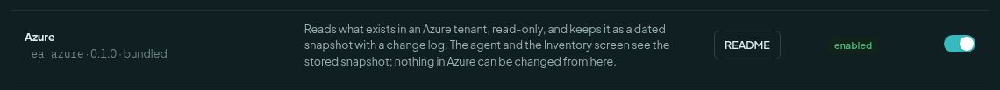
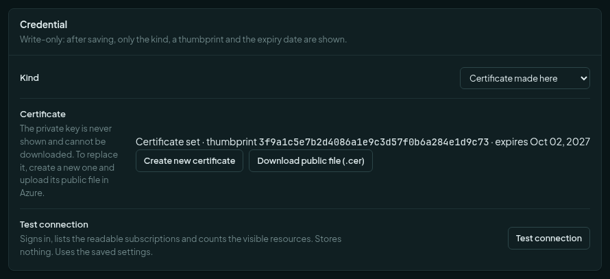
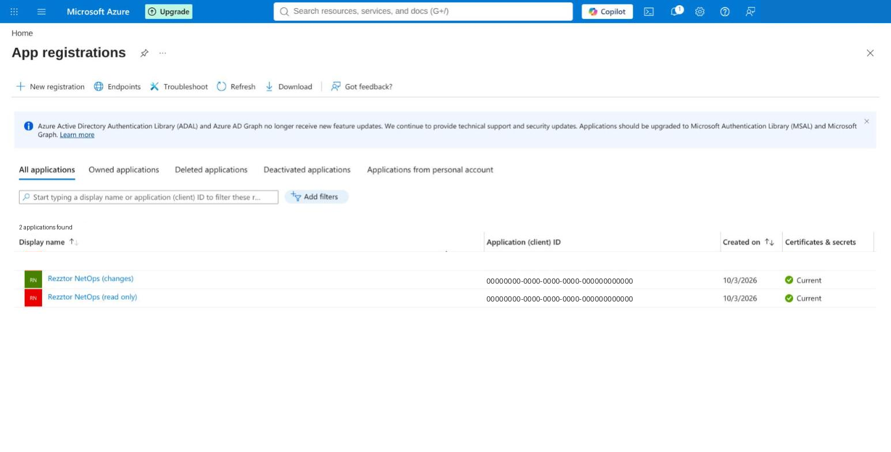
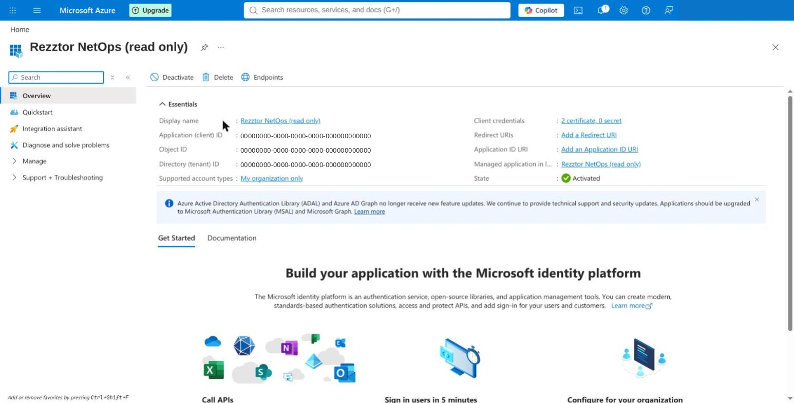
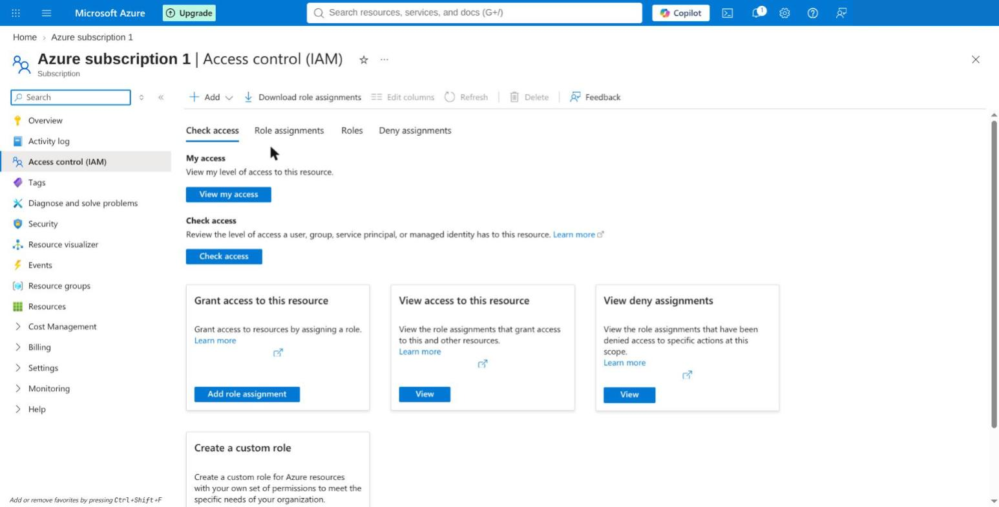
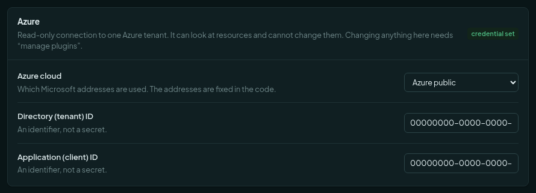
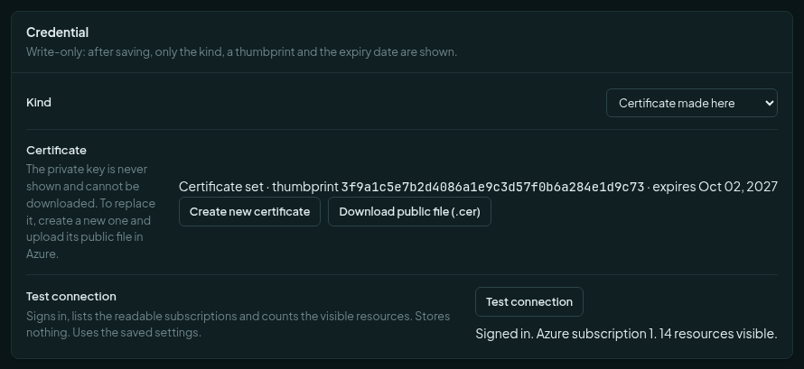
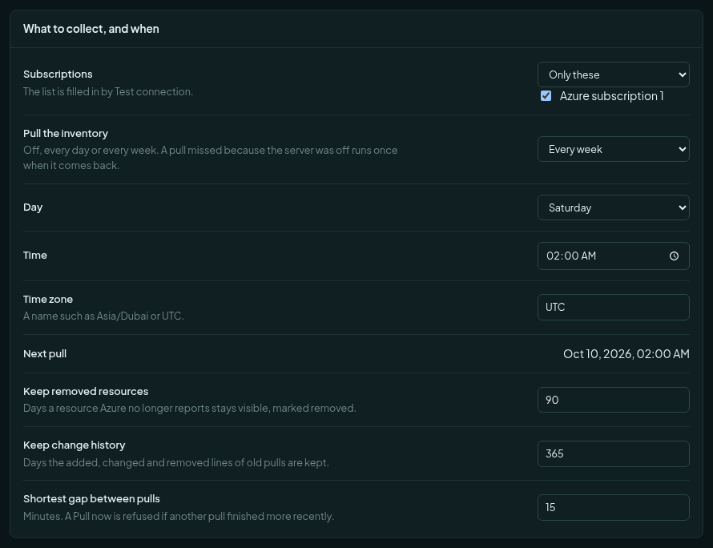
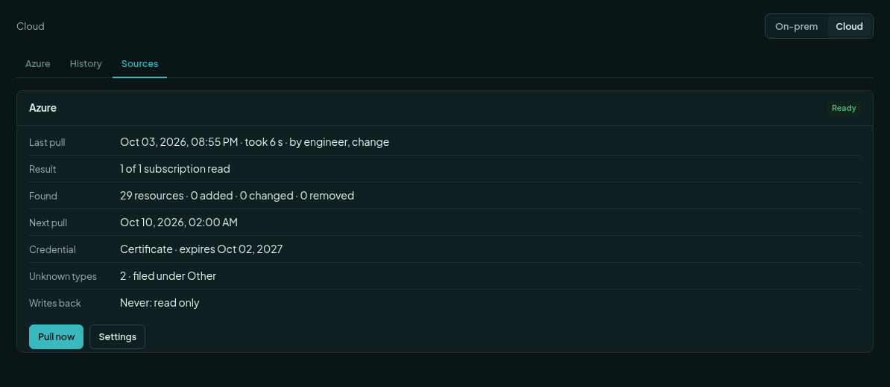
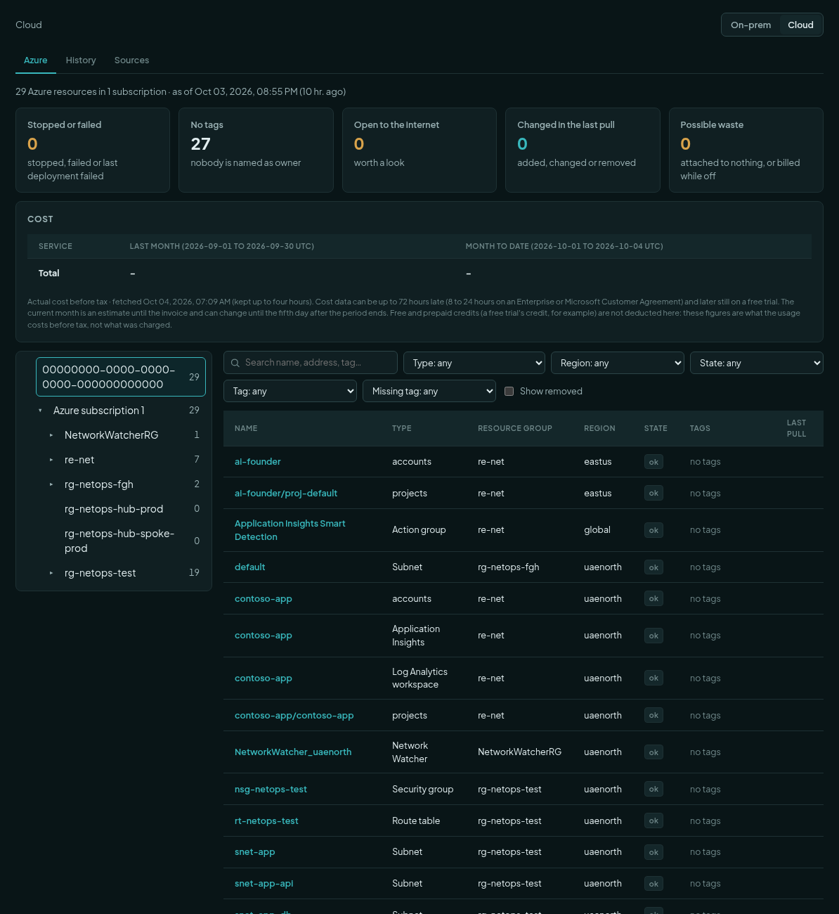

# Connect Azure, read-only

This guide connects the product to one Azure tenant so it can read it. It takes about ten minutes. You do it once.
Nothing here lets the product change anything in Azure.

Other Azure guides: [Use the inventory and the chat](azure-using-inventory-and-chat.md) ·
[Troubleshoot from the chat](azure-troubleshooting.md) · [Reference](azure.md) ·
Optional: [Set up Azure changes](azure-changes-setup.md), [Approve a change](azure-approving-a-change.md).

## What the product reads, and what it never does

It reads: subscriptions, resource groups, resources and their settings (names, sizes, regions, address ranges,
routes, security rules). It also reads what Azure itself says about them: Advisor recommendations, policy results,
health, and who changed what in the last 14 days. And it reads cost.

It never does these:

- It never creates, changes, stops, restarts or deletes anything in Azure.
- It never stores a password, a key, a connection string or an app setting.
- It never uses your own sign-in. It signs in as a small account for programs, called an *app registration*. That
  account holds the **Reader** role and nothing more.

If the assistant suggests a fix that removes or stops something, it only writes it down for an engineer to do by hand.

## What you need

- An Azure **tenant** and a **subscription** to look at.
- Someone who can **register an app** in Microsoft Entra. This is the *Application Developer* role, or the tenant
  setting that lets users register apps.
- Someone who can **assign a role** on the subscription: *Owner*, *User Access Administrator* or
  *Role Based Access Control Administrator*.
- A product administrator (the permission `plugins.manage`).
- Outgoing HTTPS (port 443) from the product to `login.microsoftonline.com` and `management.azure.com`.

The Reader role is built in to Azure. You do not upload a file for it.

## Steps

### 1. Turn the Azure plugin on

1. Sign in to the product as an administrator.
2. Open **Plugins** in the left menu.
3. Find the row **Azure** (`_ea_azure`). Switch it on. The state reads **enabled**.

### 2. Make the certificate

The product signs in to Azure with a certificate. The private half is made inside the product. It is never shown and
cannot be downloaded.

1. Open **Settings**, then **Azure** (under *Integrations*).
2. In the card **Credential**, keep **Kind** as *Certificate made here*.
3. Press **Create certificate**. On a first setup the button has this name. In the picture below a certificate already
   exists, so the button reads **Create new certificate**.
4. Press **Download public file (.cer)**. Keep this file. You upload it to Azure in step 5.

The card then shows the certificate's thumbprint and the day it expires. Write the expiry date in your calendar.

### 3. Register the app in the Azure portal

1. Open the Microsoft Entra admin center, then **App registrations**.
2. Press **New registration**.

3. Give it a name, for example `Rezztor NetOps (read only)`.
4. Keep **Single tenant**. Leave the redirect address empty.
5. Press **Register**.

### 4. Copy the two IDs

1. On the new app's **Overview** page, copy the **Directory (tenant) ID**.
2. Copy the **Application (client) ID**.

They are identifiers, not secrets. Keep them for step 7.

### 5. Upload the certificate

1. In the same app, open **Certificates & secrets**, then **Certificates**.
2. Press **Upload certificate**.
3. Choose the `.cer` file from step 2. Press **Add**.

You do not add an API permission. You do not press "Grant admin consent". Access comes from the role in step 6.

### 6. Give the app the Reader role

Choose where to give it:

| Where | What the product can then read |
| --- | --- |
| One subscription | Only that subscription. Best for a first test. |
| A management group (recommended for the real setup) | Every subscription under it, and new ones you place there. |
| The top management group | The whole tenant. Only a Global Administrator can assign here. |

1. In the Azure portal, open that subscription (or management group), then **Access control (IAM)**.
2. Press **Add**, then **Add role assignment**.

3. On the **Role** tab, choose **Reader**. It is in the list of job function roles.

4. On the **Members** tab, choose **User, group, or service principal**. Press **Select members**. Search for the
   app's name from step 3 and select it.
5. Press **Review + assign**.

The assignment must be active and permanent. An *eligible* assignment does not work for a program.

### 7. Enter the two IDs and save

1. Go back to the product: **Settings**, **Azure**.
2. In the first card, paste the **Directory (tenant) ID** and the **Application (client) ID**.
3. Press **Save** in the bar at the bottom.

### 8. Test the connection

1. In the **Credential** card, press **Test connection**. It needs saved settings. If the bar says to save first, save.
2. Wait a few seconds.

A good result reads like this. It names each subscription and counts the resources Azure reports.

The count here is the number Azure reports for resources. The inventory screen is larger, because it also lists
each subnet on its own line.

**"No role yet" looks like this.** The sign-in worked, but the Reader role is missing or has not arrived yet. The
test shows a yellow line:

> Signed in, but no subscription is readable. Give the app the Reader role (step 5 of the setup).

Go to step 6 (in this guide). Check the app is the member. Wait two minutes and test again.

Test connection stores nothing. It only checks.

### 9. Choose what to collect, then Pull

Still in **Settings**, **Azure**, the card **What to collect, and when** sets the subscriptions and the schedule.
Test connection fills in the subscription list. The default is a pull every Saturday at 02:00 UTC. A pull that was
missed because the server was off runs once when it comes back.

To read Azure now:

1. Open **Inventory** in the left menu. Switch to **Cloud**.
2. Open the **Sources** tab.
3. Press **Pull now**. A pull is refused if another one finished less than 15 minutes ago.

### 10. Where the result is

Go to **Inventory**, then **Cloud**, then **Azure**. You see the tree of subscriptions and resource groups, the list
of resources, the attention tiles and the cost box. The text above them says how old the picture is.

Now read [Use the inventory and the chat](azure-using-inventory-and-chat.md).

## If something does not work

| What you see | Why | What to do |
| --- | --- | --- |
| *Azure does not know that Directory (tenant) ID.* | The tenant ID is wrong. | Copy it again from the app's Overview page (step 4). |
| *That Application (client) ID is not registered in this directory.* | The client ID is wrong, or from another tenant. | Copy it again from the same Overview page. |
| *Azure did not accept the certificate.* | The `.cer` was not uploaded, or it is an old one. | Upload the file from step 2 under **Certificates & secrets**, **Certificates** (step 5). If you pressed Create new certificate since, upload the new file. |
| *The credential has expired.* | The certificate passed its expiry date. | Press **Create new certificate**, download the file, upload it in Azure. |
| *Microsoft could not be reached.* | The firewall blocks the product. | Allow outgoing HTTPS to `login.microsoftonline.com` and `management.azure.com`. |
| *Signed in, but no subscription is readable.* | The Reader role is missing, is on the wrong level, or is only *eligible*. | Do step 6 again. Make it permanent. Wait two minutes. |
| The test works but **Pull now** does nothing. | Another pull finished less than 15 minutes ago. | Wait, then press it again. |
| A subscription shows *not readable since*. | The app lost its role on it. | Give the Reader role again. |
| The cost box shows a dash. | Azure has not reported cost yet. | See [Use the inventory and the chat](azure-using-inventory-and-chat.md). |
| **Test connection** is greyed out. | There are unsaved changes. | Press **Save** first. |

The full list of settings is in [Azure cloud inventory](azure.md).
