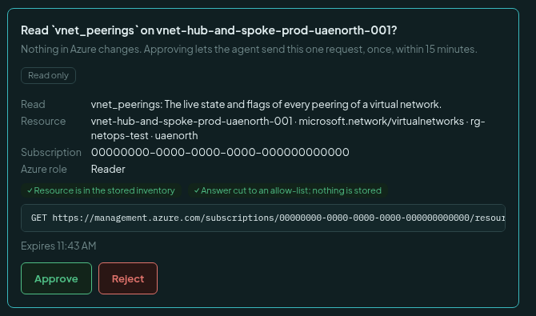
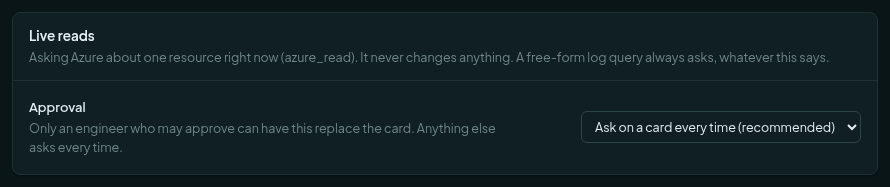
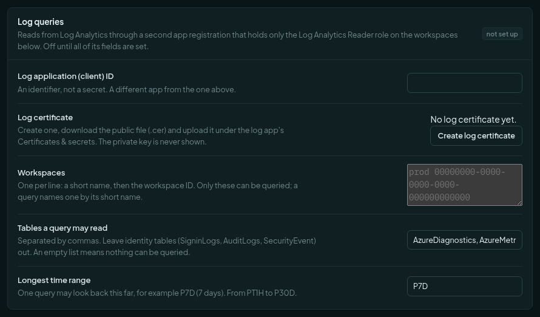
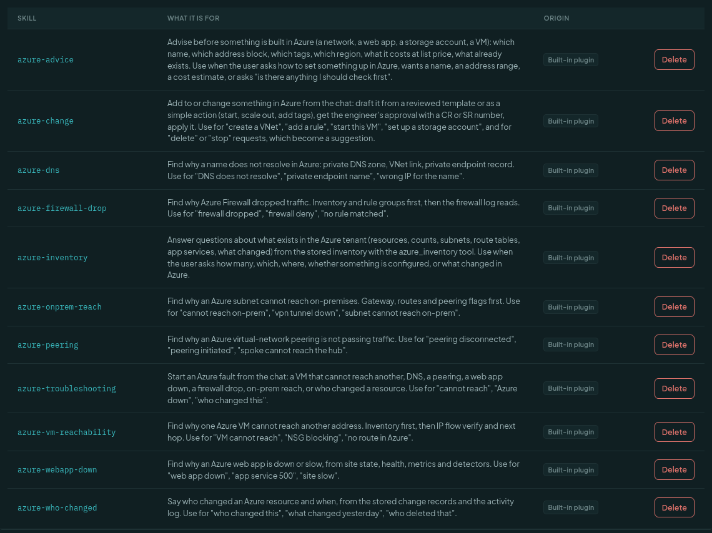
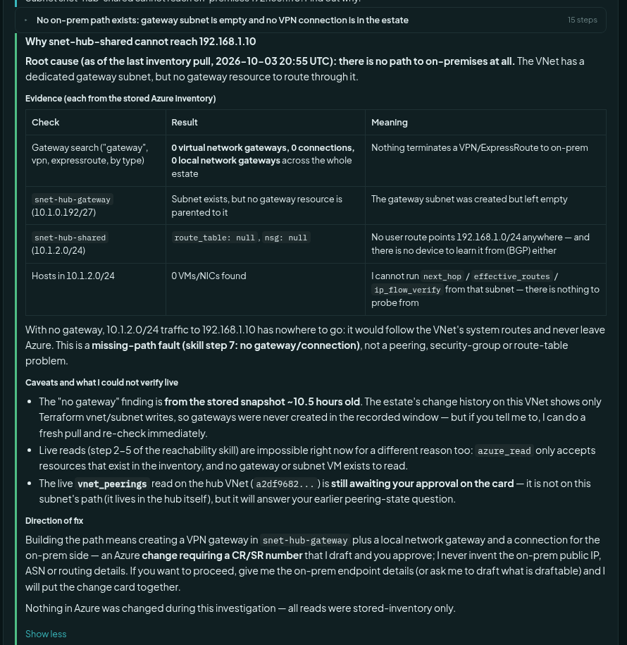

# Troubleshoot Azure from the chat

This guide shows how to find a fault in Azure by asking the assistant. It also covers two optional extras: the
**Diagnostics role** (network probes) and the **log app** (firewall and diagnostic logs). Everything here is read-only.
Nothing in Azure changes.

Start with [Connect Azure, read-only](azure-setup-read-only.md). Then read
[Use the inventory and the chat](azure-using-inventory-and-chat.md). Reference: [Azure cloud inventory](azure.md).

## Stored answers and live answers

| | Stored | Live |
| --- | --- | --- |
| Where it comes from | The last pull. | Azure, right now. |
| Needs approval | No. | Yes, on a card in the chat (unless a standing setting covers it). |
| Costs | Nothing. | One read call to Azure. |
| Use it for | What is configured. | What is true now. |

The assistant always tries the stored picture first. It asks Azure live only when the question is about now.

## Live reads

When the assistant needs the live state of one resource, it shows a **read card** and waits. It runs nothing until you
press **Approve**.

1. Ask a question about now. For example: *Right now, in Azure itself, what state are the peerings of
   vnet-hub-and-spoke-prod-uaenorth-001?*
2. The assistant shows the card.
3. Read the card. Check the resource and the read.
4. Press **Approve**, or **Reject**.



What the card tells you:

- **Read**: the name of the question and what it returns.
- **Resource** and **Subscription**: exactly what it will ask about.
- **Azure role**: which role the read needs. *Reader* for a plain read. *Diagnostics* for a probe (below).
- Two green ticks: the resource is in the stored inventory, and the answer is cut to a list of allowed fields. Nothing
  is stored.
- The one request it will send, as text. It is a `GET`, or for a probe a `POST` that only asks a question.
- **Expires**: the card is valid for 15 minutes. A new one can be requested.

Typing "approved" in the chat approves nothing. Only the button does.

After you approve, the assistant runs the read and reports the answer with the time it was read. The answer is not
kept. Ask again for a later answer.

### The approval setting

An administrator chooses how often the card appears: **Settings**, **Azure**, card **Live reads**, field **Approval**.



| Choice | Meaning |
| --- | --- |
| Ask on a card every time (recommended) | Every live read shows a card. |
| Ask once per resource in a chat | After you approve one read on a resource, other reads on it in that chat run without a card. |
| Do not ask; record it in the audit log | No card. Each read is recorded in the audit log. |

Only a person who may approve can have a setting replace the card. Anyone else is asked every time. A free-form log
query always asks, whatever this says.

## Probes and the Diagnostics role (optional)

A *probe* asks Azure a question that a plain read cannot answer: which routes really apply to a network interface, which
rule would block this packet, where a packet goes next. Probes change nothing in Azure. But Azure counts them as
actions, so the built-in **Reader** role is refused (error 403).

The custom role **Rezztor Diagnostics** adds exactly these probes to Reader:

- effective routes and effective security rules of a network interface;
- IP flow verify (would a rule allow this packet?);
- next hop (where does a packet go?);
- network configuration diagnostic, and connection check;
- gateway BGP status, learned routes and advertised routes.

It adds nothing that writes, deletes, stops, captures packets, runs a command, or reads a shared key. Without it the
assistant still works. It says the answer is "configured, not effective" and names the gap.

### Add the role

You need the Owner or User Access Administrator role on the subscription.

1. Download the file: `docs/guides/azure/roles/rezztor-diagnostics-role.portal.json` (it is also shown below).
2. Open it in a text editor. In `assignableScopes`, replace the zeros with your subscription ID. Add a line for each
   subscription, or use a management group path. Do **not** assign it at the tenant root. Save the file.
3. In the Azure portal, open the subscription, then **Access control (IAM)**.
4. Press **Add**, then **Add custom role**.
5. On the **Basics** tab, choose **Start from JSON**. Select your saved file.
6. Press **Next** until **Review + create**, then **Create**.


7. Press **Add**, then **Add role assignment**. Choose the role **Rezztor Diagnostics**.
8. On **Members**, select the **read app** (the app from the read-only guide). Press **Review + assign**.

Give it **in addition** to Reader, not instead of it. The portal accepts only its own layout (`properties.roleName`
and so on). The file above is in that layout. The command-line layout is shown in [Azure cloud inventory](azure.md).

The **Reader** role needs no file. It is built in to Azure.

```json
{
  "properties": {
    "roleName": "Rezztor Diagnostics",
    "description": "Reader's */read plus named network probes that change nothing. No write, delete, packet capture, VPN troubleshoot, or shared key.",
    "assignableScopes": [
      "/subscriptions/00000000-0000-0000-0000-000000000000"
    ],
    "permissions": [
      {
        "actions": [
          "*/read",
          "Microsoft.Network/networkWatchers/ipFlowVerify/action",
          "Microsoft.Network/networkWatchers/ipFlowVerify/read",
          "Microsoft.Network/networkWatchers/nextHop/action",
          "Microsoft.Network/networkWatchers/nextHop/read",
          "Microsoft.Network/networkWatchers/securityGroupView/action",
          "Microsoft.Network/networkWatchers/networkConfigurationDiagnostic/action",
          "Microsoft.Network/networkWatchers/networkConfigurationDiagnostic/read",
          "Microsoft.Network/networkWatchers/connectivityCheck/action",
          "Microsoft.Network/networkWatchers/connectivityCheck/read",
          "Microsoft.Network/networkInterfaces/effectiveRouteTable/action",
          "Microsoft.Network/networkInterfaces/effectiveNetworkSecurityGroups/action",
          "Microsoft.Network/virtualNetworkGateways/getBgpPeerStatus/action",
          "Microsoft.Network/virtualNetworkGateways/getLearnedRoutes/action",
          "Microsoft.Network/virtualNetworkGateways/getAdvertisedRoutes/action",
          "Microsoft.Network/virtualNetworkGateways/getEffectiveRoutes/action",
          "Microsoft.Network/connections/getIkeSas/action"
        ],
        "notActions": [],
        "dataActions": [],
        "notDataActions": []
      }
    ]
  }
}
```

## Log queries (optional)

Questions such as *what did the firewall deny* are answered from a Log Analytics workspace. They use their **own app
registration**, so a leak of one key never reaches the other.

**What it adds:** log questions, for example firewall denies, flow logs, heartbeat. Answers never include who or where
from (no caller IP, no user agent), are cut at 200 rows, and are not stored.

1. In Microsoft Entra, register a second app, for example `rezztor-netops-logs`. Copy its Application (client) ID.
   It needs no API permission and no secret.
2. In the product: **Settings**, **Azure**, card **Log queries**. Paste that ID. Press **Create log certificate**.
   Download the public file (.cer). Upload it under the app's **Certificates & secrets**.
3. On each Log Analytics workspace to be queried, open **Access control (IAM)** and give the app **Log Analytics
   Reader**, and nothing else. Azure can take up to an hour to apply it.
4. Back in **Workspaces**, write one workspace per line: a short name, then the workspace ID (on the workspace's
   Overview page).
5. Check **Tables a query may read**. The default is network and platform tables. Leave sign-in and audit tables
   (`SigninLogs`, `AuditLogs`, `SecurityEvent`) out.
6. For firewall questions, the firewall's diagnostic setting must send its resource-specific tables (for example
   `AZFWNetworkRule`) to that workspace.



Until all the fields are set, the card says *not set up* and log questions are refused. A free-form query always asks
on a card. An engineer can edit the text before approving.

## The eight troubleshooting skills

A *skill* is a set of instructions the assistant loads when your words match it. You do not name a skill. You describe
the fault. The assistant loads the right one and follows its steps: stored inventory first, then live reads.

| Skill | Say something like | What it finds |
| --- | --- | --- |
| `azure-troubleshooting` | "Azure is down", "cannot reach", "who changed this" | Starts any fault and picks the right skill. |
| `azure-vm-reachability` | "VM cannot reach", "NSG blocking" | Why one VM cannot reach an address: inventory, IP flow verify, next hop. |
| `azure-dns` | "DNS does not resolve", "private endpoint name" | Private DNS zone, network link, private endpoint record. |
| `azure-peering` | "peering disconnected", "spoke cannot reach the hub" | Peering state and flags. |
| `azure-webapp-down` | "web app down", "app service 500" | Site state, health, metrics, detectors. |
| `azure-firewall-drop` | "firewall dropped", "no rule matched" | Rule groups, then the firewall log reads. |
| `azure-onprem-reach` | "cannot reach on-prem", "vpn tunnel down" | Gateway, routes and peering flags. |
| `azure-who-changed` | "who changed this", "what changed yesterday" | Change records and the activity log. |

You can see them in the **Skills** screen. Search for `azure-`.



### One worked example: a subnet cannot reach on-premises

You ask:

> Subnet snet-hub-shared cannot reach on-premises 192.168.1.10. Find out why.

The assistant loads `azure-onprem-reach`. It reads the stored inventory several times: it looks for gateways and
connections, for the subnet's route table and security group, and for machines in the subnet. It needs no approval for
that. Then it answers.



Read the answer from the top:

1. **Root cause**, with the date of the data: there is no path to on-premises. The network has a gateway subnet but no
   gateway.
2. **Evidence**, one row per check. Each says what was searched, what came back, and what it means. Here: 0 gateways,
   0 connections, an empty gateway subnet, no route table on the subnet, no machines to probe.
3. **Which kind of fault it is.** A missing path. It is not a peering, security-group or route-table problem.
4. **Caveats.** The data is about ten hours old. A live read is impossible here because there is nothing to read
   (a read needs a resource that is in the inventory). A different live read from the same chat is still waiting for
   your approval on its card.
5. **Direction of fix.** To build the path, a gateway, a local network gateway and a connection are needed. That is an
   Azure change. It would need a CR or SR number, and the on-premises endpoint details, which the assistant will not
   invent. The last line says nothing in Azure was changed.

If the data may be stale, ask for a fresh pull. An administrator or engineer with the right permission presses
**Pull now** in the Cloud screen, **Sources** tab. The assistant itself never changes Azure.

## If something does not work

| What you see | Why | What to do |
| --- | --- | --- |
| The card says it expired. | You waited more than 15 minutes. | Ask the assistant to request it again. |
| "The Azure role lacks an action." | A probe needs the Diagnostics role. | Add the role (above) to the read app. Wait a few minutes. |
| "That resource is not in the inventory." | A live read takes only a resource the last pull saw. | Press **Pull now**, then ask again. |
| Azure is limiting requests. | Azure throttles. | Wait. The assistant does not retry in a loop. |
| A probe on a stopped virtual machine is refused. | Azure refuses it. | Start the machine by hand, or use a stored answer. |
| Log questions are refused. | The log app is not set up, or the table is not in the allowed list. | Finish the **Log queries** card. |
| A log question returns nothing for the firewall. | The firewall does not send its logs to the workspace. | Add the diagnostic setting on the firewall (step 6). |
