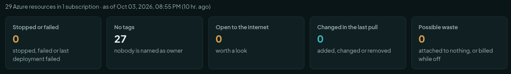
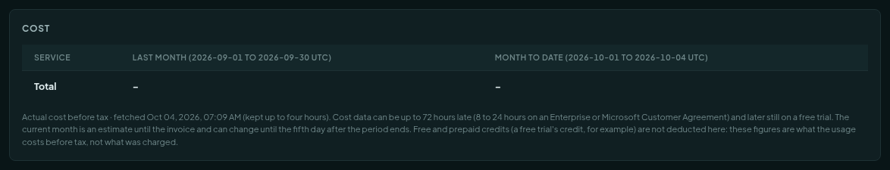
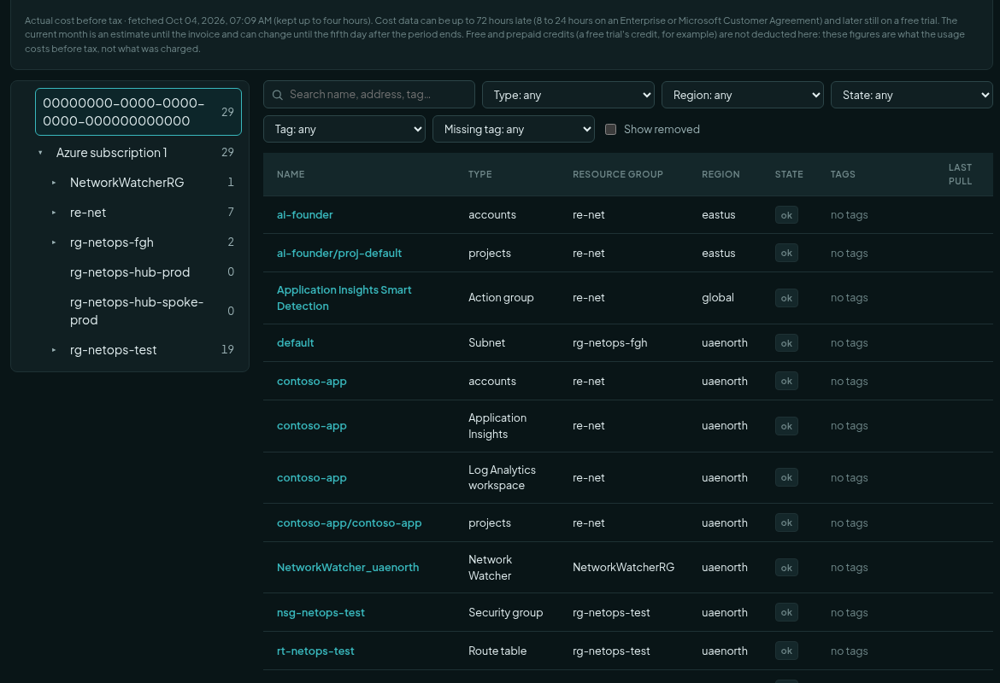
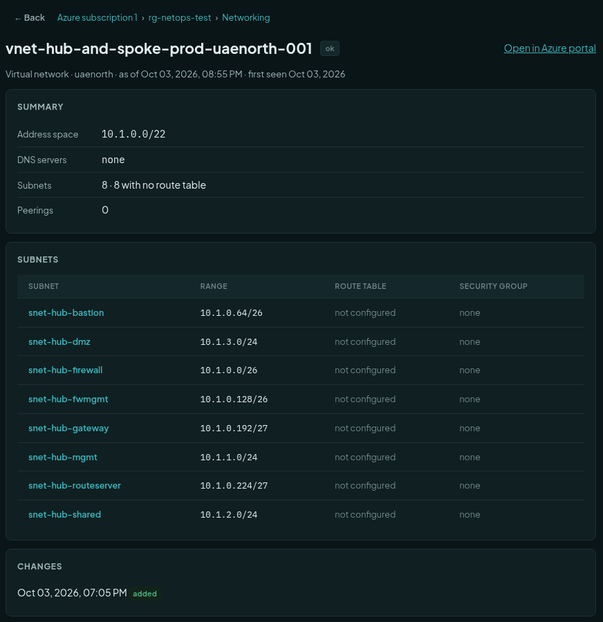
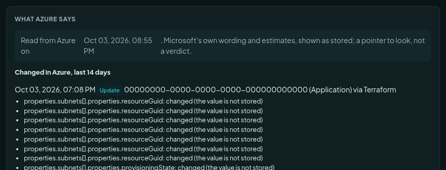
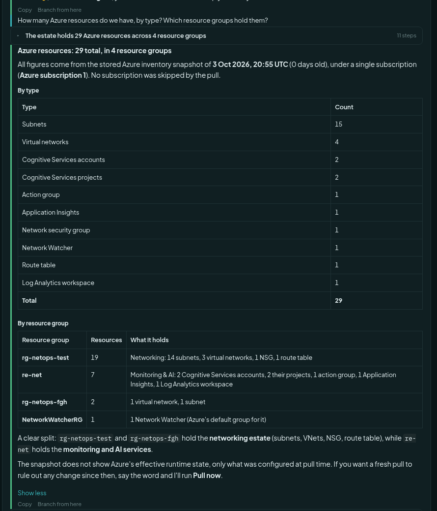
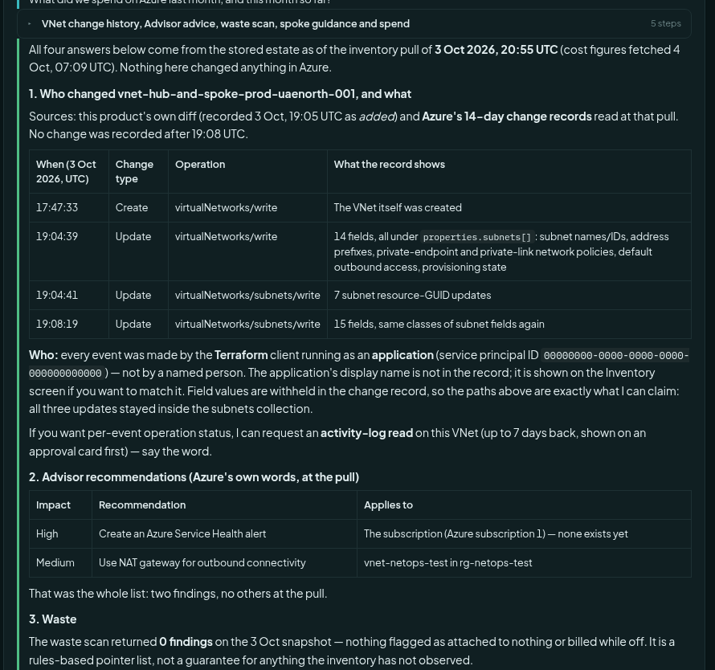
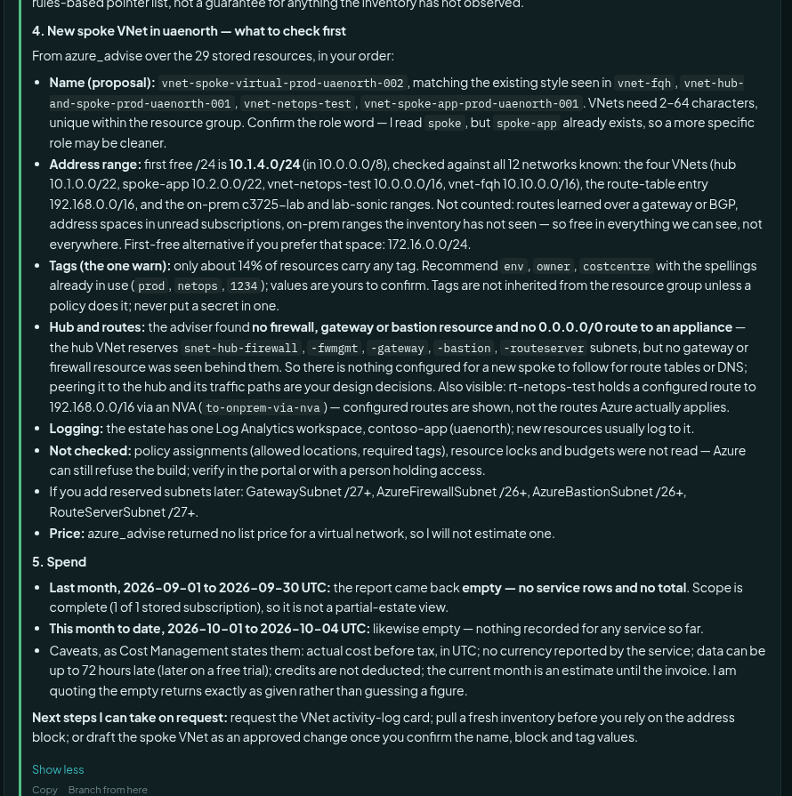

# Use the Azure inventory and the chat

This guide is for engineers. It shows the Cloud screens and the questions you can ask in the chat. Everything here is
read-only. The administrator connects Azure first: [Connect Azure, read-only](azure-setup-read-only.md).

Next: [Troubleshoot Azure from the chat](azure-troubleshooting.md). Reference: [Azure cloud inventory](azure.md).

## The Cloud screens

1. Open **Inventory** in the left menu.
2. Press **Cloud** at the top right. The tabs are **Azure**, **History** and **Sources**.
3. Stay on **Azure**.

The line under the tabs tells you how old the picture is, for example:
*29 Azure resources in 1 subscription · as of Oct 03, 2026, 08:55 PM (10 hr. ago)*.
It is a picture from the last pull. It is not live. A question that needs now is covered in
[Troubleshoot Azure from the chat](azure-troubleshooting.md).

### The attention tiles

Five tiles sit at the top. Each one counts resources that deserve a look. Press a tile to filter the list to those
resources. Press it again to clear the filter.

| Tile | What it counts |
| --- | --- |
| Stopped or failed | Resources that are stopped or failed, or whose last deployment failed. |
| No tags | Resources with no tag, so nobody is named as owner. |
| Open to the internet | Resources that look reachable from the internet. Worth a look. It is not a verdict. |
| Changed in the last pull | Resources added, changed or removed since the pull before. |
| Possible waste | Resources attached to nothing, or billed while off. For example a disk with no machine. |

A sixth tile, **Drifted**, appears only if the optional *Azure changes* feature is on. It counts resources the
product made that someone later changed in the portal. It stays hidden when the count is zero. In this tenant it is
zero.

The waste list has a **Why** column that says why each resource was flagged. It is a pointer for you to look, not a
decision. Nothing is ever removed for you.

### The cost box

Below the tiles you see what the tenant paid last month and so far this month, by service.

**Why cost can be empty for 48 hours.** Azure reports cost late. The data can be up to 72 hours old. For a new
subscription, Azure may report nothing for the first 48 hours. A free trial reports later still. The box shows a dash
until Azure has something to say. The note under the table says the same. It also says that:

- the figures are **actual cost before tax**, in the currency Azure reports;
- credits (for example a free trial's credit) are **not deducted**;
- the current month is an **estimate** until the invoice.

The product asks Azure for cost at most once every four hours for each question.

### The tree and the list

On the left is the tree: subscription, then resource group, with a count on each. Press a node to see only its
resources. On the right is the list. You can search by name, address or tag, and filter by type, region, state and
tag.

A subnet is listed as its own line. That is why the list is longer than the count Azure gives in *Test connection*.

### A resource page

Press a name in the list. The page opens on the right.

From the top:

- The breadcrumb, the name, the state, and a link **Open in Azure portal**.
- **Summary**: the settings that matter for this type. For a network, the address space, the DNS servers, the subnets
  and the peerings. A virtual machine, a web app and others have their own blocks.
- **Subnets** (for a network): each with its range, route table and security group.
- **Changes**: when the product first saw it, and every change since.

### What Azure says

At the bottom of the page is the section **What Azure says**. It holds what Azure itself reported about this resource,
in Microsoft's own words. It has up to four parts:

| Part | What it is |
| --- | --- |
| Health | Whether Azure thinks the resource is available. Today for virtual machines. |
| Advisor | Microsoft's recommendations: cost, security, reliability, performance, operations. |
| Policy it does not meet | Azure Policy rules the resource breaks. |
| Changed in Azure, last 14 days | Who changed it, when, and which settings. |

Read the picture above. It says when Azure was read. Then each change shows the time, the kind (Create or Update), who
did it (here an application, shown as `00000000-0000-0000-0000-000000000000` because this guide hides real IDs) and the
settings that moved. Where it says *the value is not stored*, the product keeps the name of the setting but not its
value. A secret can never land here that way.

If a part is empty, Azure reported nothing. Before the first pull ever ran, the page says the findings have not been
read yet.

## Ask in the chat

Open **Chat**. Pick the agent *NetOps Operator*. Then ask. The assistant reads the stored picture. It says how old
it is. It never changes Azure. A question can need several tools, and the assistant chooses them. You do not name them.

Good questions to start with:

| You ask | What you get |
| --- | --- |
| How many Azure resources do we have, by type? Which resource groups hold them? | Counts by type and by group. |
| Which subnets have no route table? | A list, from the stored settings. |
| Who changed *vnet-name* recently? | The change records: when, what operation, who. |
| What does Azure Advisor recommend? | Microsoft's findings with impact and the resource. |
| Is there any waste? | The waste list, or "0 findings". |
| I want to build a spoke network in uaenorth. What should I check first? | Advice before building. |
| What did we spend last month? | The cost answer, or an honest "empty". |

### Inventory: how many and where

The answer starts with the date of the picture. It gives a table by type, a table by resource group and a plain
sentence. At the end it offers a fresh pull if you need one.

### Who changed it, Advisor and waste

You can put several questions in one message. The assistant answers each one.

- **Who changed it.** A table of the change records, with the time (in UTC), the kind of change, the operation and
  what moved. It names *who* as Azure gives it. Here every change came from an application, so there was no person's
  name. The assistant said so and did not invent one. It offers a deeper look at the activity log, which is a live read
  that shows a card first.
- **Advisor.** A table: impact, the recommendation in Azure's words, and what it applies to. It says whether that was
  the whole list.
- **Waste.** The count of findings. A count of 0 is a real answer. It adds that this is a pointer list from rules, and
  not a guarantee about anything the inventory has not seen.

### Advice before you build

Ask this before you create anything. The assistant checks what exists and tells you:

- **Name.** A name in the style your estate already uses, and Azure's naming rules.
- **Address range.** The first free block, checked against every network it knows, including on-premises ranges it has
  seen. It lists what it could not check.
- **Tags.** Which tags your resources already use, and how few resources carry any.
- **Hub and routes.** What exists to peer with, and whether a gateway or firewall is there.
- **Not checked.** Azure Policy, locks and budgets. Azure may still refuse the build. It says so.
- **Price.** A list price when the price list has one. If it has none, it says it has none and does not guess.

List prices are Microsoft's public prices for 730 hours a month. They exclude data transfer and your discounts.

### Cost

The same screenshot ends with a cost answer. In this tenant it said both periods were **empty**. It repeated
Azure's own caveats: actual cost before tax, up to 72 hours late, credits not deducted. It said the scope was complete
(1 of 1 subscription), so the empty result was not a gap in what it covers. It quoted the empty answer exactly and did
not make up a figure.

If you see this, wait. Azure fills cost in after a day or two. Ask again the next day.

## What the assistant never does here

- It never changes Azure from these questions.
- It never shows a key, a token, an app setting or a connection string.
- It never adds up Advisor savings. It quotes each one as Microsoft states it.
- If a fix means removing or stopping something, it writes a suggestion with steps for you to do by hand.

Next: [Troubleshoot Azure from the chat](azure-troubleshooting.md).
