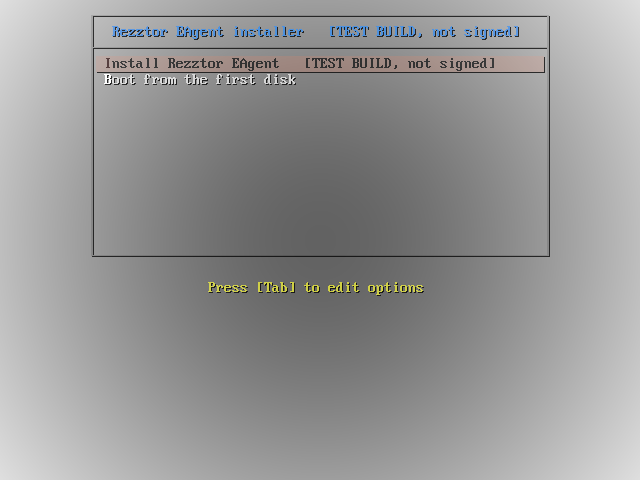
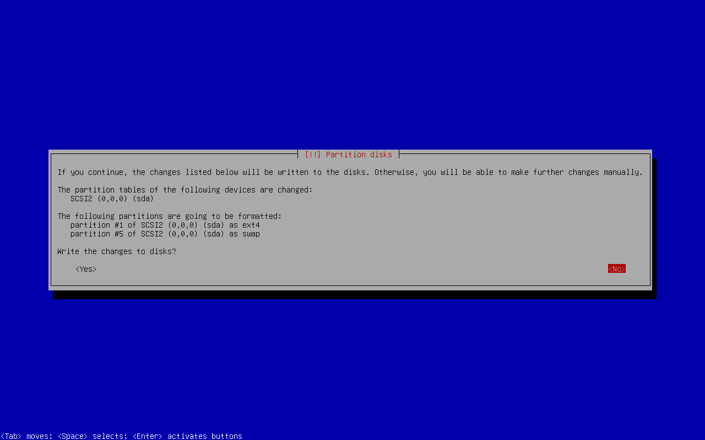
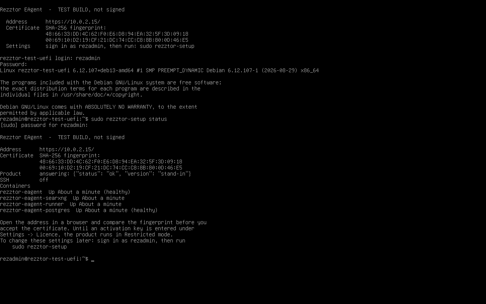
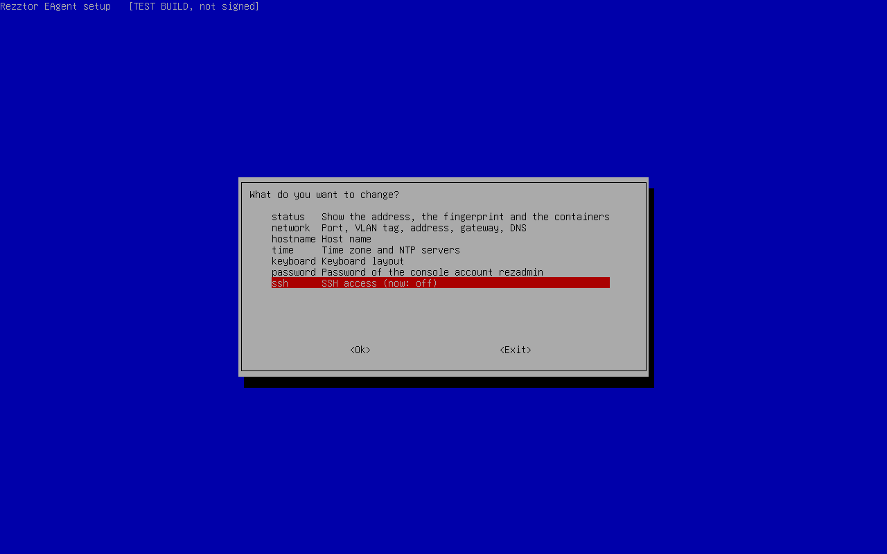

# Install Rezztor EAgent from the test ISO on VMware

This guide is for the **test ISO** (`rezztor-eagent-TEST-<date>.iso`). Every screen of it says
"TEST BUILD, not signed". It installs the operating system (Debian 13), Docker and the product on one virtual
machine. The installation itself needs no network. After it, the machine needs outbound HTTPS and DNS only to
activate the licence.

> **Status of this build.** The ISO was installed automatically in QEMU on UEFI and on legacy BIOS, with a
> paravirtual SCSI disk, a SATA disk, and the VMXNET 3 and E1000 network cards. It has **not yet been installed on
> VMware**. The test machine had no hardware virtualization, so the automatic test used small stand-in container
> images in place of the real ones, and it answered the console questions from a file. The questions themselves
> were typed through in a terminal, not on a virtual machine's console. Your run is the first full one. If a step
> here does not match what you see, write down the step and the text on the screen.

Time: about 30 to 45 minutes. This is an estimate: most of it is copying and loading 7 GB of container images, and
that was not measured.

## 1. What you need

| | |
| --- | --- |
| The ISO file | About 7 GB. Check it first: `sha256sum rezztor-eagent-TEST-<date>.iso` (Linux, macOS) or `Get-FileHash rezztor-eagent-TEST-<date>.iso` (Windows PowerShell). Compare with the `.sha256` file beside it. |
| VMware | ESXi 7 or 8, or Workstation 17. |
| An activation key | `REZ-XXXXX-XXXXX-XXXXX-XXXXX-XXXXX`. It is **not** on the ISO. You type it in the browser at the end. |
| A network with DHCP, or a free address | Plus its prefix, gateway and DNS server if you type the address yourself. |

## 2. Create the virtual machine

| Setting | Value |
| --- | --- |
| Guest operating system | Linux, **Debian GNU/Linux 12 (64-bit)** (or 13 if your VMware lists it) |
| Firmware | **EFI** or **BIOS**. Both work. |
| Secure Boot | **Off.** With EFI firmware, untick *Enable UEFI secure boot* (ESXi: VM Options → Boot Options; Workstation: Options → Advanced). This build does not put a signed boot loader on the disk, so with Secure Boot on the machine would not start after the install. |
| Processors | 4 or more |
| Memory | **16 GB**. 8 GB is the lowest the product's installer accepts without a warning. |
| Hard disk | **80 GB**, thin provisioned. Not less than 60 GB (see the note below). One disk. |
| Disk controller | **VMware Paravirtual** (the default for this guest type). Leave it as it is. |
| Network adapter | VMXNET 3 (the default) or E1000. One adapter. |
| CD/DVD drive | The ISO file, with **Connect at power on** ticked |

Note on the disk: the six container images take about 21 GB unpacked. Docker also keeps them packed (about 7 GB),
and the installer first copies the 7 GB from the ISO to the disk and removes that copy after loading. That is about
37 GB at the highest point, plus Debian (about 2 GB), swap and your data. These numbers are calculated from the image
sizes, not measured on a full install.

**ESXi:** upload the ISO to a datastore first (Storage → Datastore browser → Upload). Then: Virtual Machines →
Create / Register VM → Create a new virtual machine → the settings above → CD/DVD Drive 1: *Datastore ISO file*.

**Workstation:** File → New Virtual Machine → **I will install the operating system later** → Linux, Debian 12.x
64-bit → the settings above. Then VM → Settings → CD/DVD → *Use ISO image file*. To choose the firmware: VM →
Settings, the *Options* tab, Advanced, Firmware type. For the network, *Bridged* puts the machine on your network; *NAT*
also works, and then only your own computer reaches it.

## 3. Install (about 10 to 15 minutes, no network needed)

1. Power on the machine. The boot menu appears and waits; there is no countdown.

   

2. Choose **Install Rezztor EAgent [TEST BUILD, not signed]** and press Enter.
3. The installer loads and asks **one thing: the disk**.
   - With one disk it shows what it will do and asks **"Write the changes to disks?"**. The answer **No** is
     selected. Press the Left arrow (or Tab) to move to **Yes**, then Enter. **Everything on that disk is erased.**
   - With more than one disk it first asks **"Select disk to partition"**. Choose the disk, then confirm as above.

   

4. Wait. The installer shows progress bars. Near the end the bar stays at **"Running preseed..."** for several
   minutes: this is the 7 GB of images being copied to the disk and checked, and Docker being installed. This is
   expected. If a file on the ISO is damaged, a red screen says that a command failed; then check the ISO's checksum
   and upload it again.
5. The machine restarts by itself. If it starts the installer again, disconnect the CD/DVD drive and restart it.

## 4. First boot: the console questions

After the restart the console shows the setup tool: blue screens with one question each. Use Tab and Enter to
move. Nothing has a default password. A wrong answer is explained and asked again.

| # | Question | Example answer | Rule |
| --- | --- | --- | --- |
| 1 | Keyboard layout code | `us` | A layout code such as `us`, `gb`, `de`, `fr`. Applied at once, before you type a password. |
| 2 | Password for the console account `rezadmin` (typed twice) | `correct-horse-battery-1` | At least 15 characters. Used to sign in on this console (and over SSH, if you switch it on). |
| 3 | The network: the interface you reach this machine on (plain text, not a blue screen) | Enter for DHCP, or `n` and a typed address | See "The network step" below. |
| 6 | Host name | `rezztor-eagent` | Letters a-z, digits, hyphens, dots. |
| 7 | Time zone | `UTC` or `Asia/Colombo` | A name from the time zone database. |
| 8 | NTP servers | *(empty)* | Empty uses the clock of the virtual machine. The clock must be right: the licence and the certificate depend on it. |
| 9 | User name of the product's first administrator | `admin` | 3 to 32 of `a-z 0-9 . _ -` |
| 10 | Password of that administrator (typed twice) | `Blue.Kettle-Seven7!` | At least 15 characters: letters, digits and `. _ , : ; ! ? @ % + = / ^ * ~ -` |

Then a summary asks **"Apply these settings?"**. Choose **Yes**.

### The network step

First boot sets up **one** interface: the network you will use to reach the machine. More interfaces are added
later from the console menu (`sudo rezztor-setup network`). If the machine has more than one network adapter,
choose the port from the list (it shows each MAC address and whether the link is up). Then press Enter if the
network gives the machine its address (DHCP), or answer `n` and type the address with its prefix
(`192.168.10.20/24`), the gateway (`192.168.10.1`) and up to three DNS servers. The network is set up and tested
at once:

<!-- screen: flat -->
```text
The network: the interface you reach this machine on. More interfaces are added later, from the console menu.
Does the network give this machine its address by itself (DHCP)? [y]:
Network port:   ens192, up, gateway answers
Address:        192.168.10.57/24  (from DHCP)
Gateway:        192.168.10.1
Web interface:  https://192.168.10.57
Keep these settings?  Type keep or back, then Enter.   Going back by itself in 120 s
keep
Kept.
```

Type `keep` and press Enter within 120 seconds. Without it the machine goes back to having no network and asks again.

With **several networks** (one for the internet and the users, others for the devices), finish the first boot on the
network you reach the machine on, then add the others from the menu. Follow one of:
[one network card per port group](appliance-vcenter-three-port-groups.md),
[one trunk port group](appliance-vcenter-trunk-port-group.md), or
[a physical server on a trunk port](appliance-physical-server-trunk.md).

The tool now sets up the machine and installs the product. It prints one line for each step. The longest step is
"Checking and loading the container images" (several minutes) and then "Waiting for the product to answer".
All passwords and keys of the product are made on this machine at this moment.

## 5. The status screen

When it has finished, the console shows the address, the fingerprint of the certificate and the state of each
container:



(The picture is from the automatic test: it shows `sudo rezztor-setup status` after signing in, with stand-in
images. Your screen shows the same lines.)

Write down the **SHA-256 fingerprint**. Press Enter; the normal sign-in prompt of the console follows, and it shows
the address and the fingerprint again.

## 6. Open the product

1. On your computer, open `https://<address>/` in a browser.
2. The browser warns about the certificate, because the machine made it itself. Open the certificate details and
   compare its SHA-256 fingerprint with the one on the console. If they are equal, accept it.
3. Sign in with the administrator name and password from questions 9 and 10.

## 7. Activate the licence

Until a key is entered, the product is in **Restricted** mode: sign-in, reading, export, settings and the licence
page work. New agent runs, new device or cloud changes and scheduled tasks do not start. Nothing is deleted.

1. Open **Settings → Licence**.
2. Type the activation key into **Activation key** and press **Activate**.

The product itself contacts `https://license.rezztor.com`. The machine therefore needs a gateway, a DNS server and
outbound HTTPS (port 443). Details: [licence-activation.md](licence-activation.md).

## 8. Change the settings later

Sign in on the console as `rezadmin` with the console password, then run:

```bash
sudo rezztor-setup
```



The menu changes the network, the host name, the time, the keyboard, the console password, and switches **SSH**
on or off (off by default; when on, only `rezadmin` can sign in, with the console password, never `root`).
A new password for a product administrator is given at the machine's own console only; over SSH the menu refuses it.
`sudo rezztor-setup status` shows the status screen again.

### If the console of your machine is closed

Some builds are delivered with a closed console. The status screen then has a line **Console closed**, and two things
are different:

- Signing in as `rezadmin`, at the console or over SSH, opens the setup menu directly. There is no command line, and
  `sudo rezztor-setup` is not typed. Leaving the menu signs you out.
- The menu has one more entry, **Support access**. It is the only way to a command line on the machine, and it is
  there for Rezztor's support: the screen shows a challenge, you read it to Rezztor, Rezztor gives you a code for it,
  and typing the code opens a root shell. A code works once, for that challenge, for a few hours. Every opening and
  closing is written to `/var/log/rezztor/setup.log` on the machine. Nothing opens without the code, and Rezztor
  cannot open it from outside: somebody at your console has to choose the entry and type what Rezztor sent.

Everything in this guide works the same on a closed console: the network, the time, updates and SSH are all on the
menu.

## 9. If something goes wrong

| What you see | What to do |
| --- | --- |
| The ISO does not boot, or the machine does not start after the install | Check the checksum of the ISO. With EFI firmware, switch Secure Boot off. |
| A red screen "No root file system is defined" | The installer does not see a disk. Power off, set the disk controller to *VMware Paravirtual*, and start again. Nothing was written. |
| A red screen at the end of the installer | A file on the ISO is damaged or the disk is too small. Check the checksum, use a disk of 80 GB. |
| "no address came from DHCP on … within 30 seconds" | Check the virtual network and DHCP, then answer the questions again, or answer `n` and type a fixed address. Later: `sudo rezztor-setup network`. |
| The network has no DHCP server and no gateway (a lab network) | Answer `n` at DHCP, type the machine's own address with its prefix, and `none` at the gateway. The machine then has no way to the internet, so the licence cannot be activated from it. |
| "Setup did not finish" | Press Enter and go through the questions again; your answers are kept. The log is `/var/log/rezztor/setup.log`. |
| The browser shows "Rezztor EAgent is starting…" | The product is still starting. Wait a minute. `sudo rezztor-setup status` shows the containers. |
| The licence cannot be activated | From the console: `curl -I https://license.rezztor.com`. If it fails, check the gateway, DNS and the firewall of your network. |

## What this test ISO does not do yet

No signature on the ISO, no web setup wizard, no backup or restore tool, no disk encryption, and no
security updates newer than Debian 13.7. An ISO built from 2026-10-10 on carries the update tool
([update-the-appliance.md](update-the-appliance.md)); it updates the product, not Debian. The full list is at the end of the ISO plan.

Network automation and the executor for Azure changes run from the first start: their secrets are made on the
machine and no token has to be typed. Azure changes stay off until the keys are made and the test in Settings,
Azure changes has passed (`azure-changes.md`, "What the administrator sets up", from step 2).
